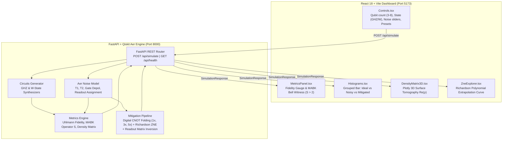

# Q-Hack2026-Hackathon
# NexQ-01: Quantum Verification & Error Mitigation Platform

[](https://python.org)
[](https://qiskit.org)
[](https://fastapi.tiangolo.com)
[](https://react.dev)
[](https://typescriptlang.org)
[](https://tailwindcss.com)

**NexQ-01** is an interactive quantum verification and automated error mitigation engine designed for the **Noisy Intermediate-Scale Quantum (NISQ)** computing era. It allows quantum researchers, algorithm designers, and students to inject realistic physical decoherence channels into multi-qubit entangled circuits, quantify quantum non-locality via Bell inequality witnesses, and reconstruct clean quantum signals using dual-layer error mitigation.

---

## Key Capabilities

1. **Entangled State Simulation ($N = 3 \text{ to } 8$ Qubits)**
   - **GHZ States**: Deterministic Hadamard + $CX$ cascade generating maximally entangled Greenberger-Horne-Zeilinger states $\frac{1}{\sqrt{2}}(|0^{\otimes N}\rangle + |1^{\otimes N}\rangle)$.
   - **W-States**: Superposition rotation gates and controlled excitation-sharing rotations generating robust single-excitation entangled states $\frac{1}{\sqrt{N}}\sum_{k} |2^k\rangle$.

2. **Configurable Hardware Noise Injection**
   - $T_1$ longitudinal thermal relaxation and $T_2$ transverse dephasing ($T_2 \le 2T_1$).
   - Single-qubit and two-qubit ($CX$) depolarizing channels ($0.0\%$ to $10.0\%$).
   - Readout assignment error matrices ($0.0\%$ to $15.0\%$).
   - Instant hardware noise presets: **IBM Quantum Heron**, **IonQ Forte**, **Severe NISQ Stress**, and **Clean Ideal**.

3. **Quantum Verification & Non-Locality Witness**
   - **MABK (Mermin-Ardehali-Belinskii-Klyshko) Bell Witness**: Dynamic multi-basis evaluation across $X$ and $Y$ Pauli projection circuits.
   - Direct non-locality certification:
     $$\text{Classical LHV Bound: } S \le 2 \quad \Longleftrightarrow \quad \text{Quantum Entangled: } S > 2$$
   - **Uhlmann Quantum State Fidelity**:
     $$F(\rho_1, \rho_2) = \left(\text{Tr}\sqrt{\sqrt{\rho_1}\rho_2\sqrt{\rho_1}}\right)^2$$
   - **3D Density Matrix Tomography**: Interactive 3D City/Surface plot representing $\text{Re}(\rho)$ and $|\rho_{jk}|$ across all $2^N \times 2^N$ basis elements.

4. **Automated Dual-Layer Error Mitigation**
   - **Zero-Noise Extrapolation (ZNE)**: Digital CNOT pulse/gate folding ($CX \to CX(CX^\dagger CX)^k$) across scale factors $\lambda \in \{1.0, 3.0, 5.0\}$ combined with **Richardson degree-2 polynomial extrapolation** back to the zero-noise limit ($\lambda \to 0$).
   - **Readout Matrix Inversion**: Tensor calibration matrix $M = M_1^{\otimes N}$ inversion using bounded linear least squares (`scipy.optimize.lsq_linear`) guaranteeing strictly physical non-negative probability distributions.

---

## System Architecture



---

## Repository Layout

```
nexq-01/
├── backend/
│   ├── app/
│   │   ├── __init__.py
│   │   ├── main.py                    # FastAPI app, CORS middleware, API endpoints
│   │   ├── schemas.py                 # Pydantic request & response models
│   │   └── quantum/
│   │       ├── __init__.py
│   │       ├── circuits.py            # N-qubit GHZ & W-state Qiskit circuit generators
│   │       ├── noise.py               # Configurable Qiskit Aer noise model builders
│   │       ├── metrics.py             # Density matrix, Fidelity, and MABK Bell witness math
│   │       └── mitigation.py          # Zero-Noise Extrapolation (ZNE) & Readout Matrix Inversion
│   ├── requirements.txt               # Dependencies
│   └── start.sh                       # Startup script for Uvicorn server
├── frontend/
│   ├── src/
│   │   ├── components/
│   │   │   ├── Controls.tsx           # Qubit selector, noise sliders, auto-mitigate toggle
│   │   │   ├── MetricsPanel.tsx       # State fidelity gauges & MABK Bell witness badge (S > 2)
│   │   │   ├── Histograms.tsx         # Plotly grouped bar chart: Ideal vs. Noisy vs. Mitigated
│   │   │   ├── DensityMatrix3D.tsx    # Plotly 3D city surface plot for real density matrix Re(rho)
│   │   │   └── ZneExplorer.tsx        # Richardson polynomial extrapolation visualization
│   │   ├── App.tsx                    # Main dark-themed dashboard layout
│   │   ├── api.ts                     # Axios API integration with FastAPI
│   │   ├── main.tsx
│   │   └── index.css                  # Tailwind styles
│   ├── index.html
│   ├── package.json                   # Dependencies
│   ├── postcss.config.js
│   ├── tailwind.config.js
│   ├── tsconfig.json
│   ├── tsconfig.node.json
│   └── vite.config.ts
├── .gitignore
├── start.sh                           # Root startup script for Linux/macOS/Codespaces
└── README.md                          # Documentation and quickstart guide
```

---

## Mathematical Derivations

### 1. MABK Bell Inequality Witness ($S > 2$)
The recursive MABK Bell operator for $N$ qubits is constructed as:
$$M_1 = 2 X_1, \quad M'_1 = 2 Y_1$$
$$M_N = \frac{1}{2} M_{N-1} (X_N + Y_N) + \frac{1}{2} M'_{N-1} (X_N - Y_N)$$
$$M'_N = \frac{1}{2} M'_{N-1} (X_N + Y_N) - \frac{1}{2} M_{N-1} (X_N - Y_N)$$

For any local realistic (hidden variable) classical theory:
$$|\langle M_N \rangle_{\text{classical}}| \le 2.0$$

For a maximally entangled $N$-qubit GHZ state, the quantum expectation value yields:
$$\langle M_N \rangle_{\text{GHZ}} = 2^{\frac{N+1}{2}}$$
- $N = 3$: $\langle M_3 \rangle = 2^2 = 4.0 > 2.0$ (**Quantum Non-Locality Verified**)
- $N = 4$: $\langle M_4 \rangle = 2^{2.5} \approx 5.657 > 2.0$
- $N = 5$: $\langle M_5 \rangle = 2^3 = 8.0 > 2.0$

Under severe environmental decoherence ($T_1, T_2 \to 0$ or gate error $\gg 0$), $S$ decays below $2.0$, witnessing **classical decoherence collapse**.

### 2. Richardson Zero-Noise Extrapolation (ZNE)
To simulate noise scaling digitally, each $CX$ gate in the circuit is replaced with an odd number of $CX$ gates:
$$CX \longrightarrow CX \cdot (CX \cdot CX)^k, \quad k \in \{0, 1, 2\}$$
Since $CX \cdot CX = I$, the logical unitary operation is preserved identically, but the physical gate exposure scales by factors $\lambda \in \{1.0, 3.0, 5.0\}$.

The Richardson polynomial weights $w_i$ satisfying $\sum_i w_i = 1$ and $\sum_i w_i \lambda_i = 0$ are:
$$w_i = \prod_{j \ne i} \frac{-\lambda_j}{\lambda_i - \lambda_j}$$
For $\lambda = [1.0, 3.0, 5.0]$:
$$w_1 = \frac{(-3)(-5)}{(1-3)(1-5)} = \frac{15}{8} = +1.875$$
$$w_2 = \frac{(-1)(-5)}{(3-1)(3-5)} = \frac{5}{-4} = -1.250$$
$$w_3 = \frac{(-1)(-3)}{(5-1)(5-3)} = \frac{3}{8} = +0.375$$

The extrapolated zero-noise probability for each bitstring $x$ is:
$$P_{\text{extrap}}(x) = \sum_{i=1}^{3} w_i P_{\lambda_i}(x)$$

### 3. Readout Matrix Inversion
For readout bit-flip error rate $e$, the single-qubit assignment matrix is:
$$M_1 = \begin{pmatrix} 1 - e & e \\ e & 1 - e \end{pmatrix}$$
The full $N$-qubit measurement calibration matrix is $M = M_1^{\otimes N}$. The ideal probability vector $\vec{p}$ is solved using bounded linear least-squares:
$$\min_{\vec{p}} \|M \vec{p} - \vec{p}_{\text{noisy}}\|^2 \quad \text{subject to } 0 \le p_i \le 1, \; \sum p_i = 1$$

---

## How to Run the Platform

### Option A: Cloud Execution via GitHub Codespaces (Recommended for Cool Laptops!)
Running on GitHub Codespaces offloads all CPU, RAM, and compilation tasks to Microsoft/GitHub cloud servers.

1. **Push this repo to GitHub** (see instructions below).
2. Go to your GitHub repository in your browser.
3. Click the green **Code** button $\to$ **Codespaces** tab $\to$ **Create codespace on main**.
4. In the Codespace terminal, run:
   ```bash
   chmod +x start.sh
   ./start.sh
   ```
5. Codespaces will automatically forward port `5173` (Frontend) and `8000` (Backend). Click the browser preview popup to use NexQ-01!

---

### Option B: Google Colab Setup
You can run the backend inside a free Google Colab GPU/CPU instance and connect the frontend:

1. Create a new notebook at [colab.research.google.com](https://colab.research.google.com).
2. Clone your repository:
   ```python
   !git clone https://github.com/<your-username>/nexq-01.git
   %cd nexq-01/backend
   !pip install -r requirements.txt pyngrok
   ```
3. Run the backend with ngrok tunnel:
   ```python
   import nest_asyncio
   from pyngrok import ngrok
   import uvicorn
   
   ngrok.set_auth_token("YOUR_NGROK_TOKEN") # Optional or use localtunnel
   public_url = ngrok.connect(8000).public_url
   print("Backend live at:", public_url)
   
   # Run server
   !uvicorn app.main:app --host 0.0.0.0 --port 8000
   ```
4. Point `VITE_API_URL` in `frontend/.env` to the ngrok public URL.

---

### Option C: Local Execution

#### 1. Start the Python Backend
```bash
cd backend
python -m venv venv

# Windows
venv\Scripts\activate
# Linux / macOS
source venv/bin/activate

pip install -r requirements.txt
uvicorn app.main:app --host 0.0.0.0 --port 8000 --reload
```
The API documentation is available at: `http://localhost:8000/docs`

#### 2. Start the Frontend
In a new terminal:
```bash
cd frontend
npm install
npm run dev
```
Open `http://localhost:5173` in your browser.

---

## Instructions to Push to GitHub

To push the complete project to your personal GitHub account:

```bash
# 1. Navigate to the project folder
cd c:\Users\Tejasvi\OneDrive\Desktop\hackathon\nexq-01

# 2. Initialize git repository
git init

# 3. Add all files
git add .

# 4. Commit files
git commit -m "Initial commit: NexQ-01 Quantum Verification & Error Mitigation Platform"

# 5. Set default branch to main
git branch -M main

# 6. Create a new repository on https://github.com/new named 'nexq-01'
# Then link remote (replace with your GitHub username):
git remote add origin https://github.com/<YOUR_GITHUB_USERNAME>/nexq-01.git

# 7. Push to GitHub
git push -u origin main
```

---

## REST API Specification

### `GET /api/health`
**Response:**
```json
{
  "status": "online",
  "engine": "Qiskit Aer",
  "version": "1.0.0",
  "platform": "NexQ-01 NISQ Verification Suite"
}
```

### `POST /api/simulate`
**Request Payload:**
```json
{
  "num_qubits": 3,
  "state_type": "ghz",
  "t1_time": 50.0,
  "t2_time": 30.0,
  "gate_error": 0.01,
  "readout_error": 0.03,
  "enable_mitigation": true,
  "shots": 2048
}
```

**Response Payload:**
```json
{
  "ideal_counts": { "000": 1024, "111": 1024 },
  "noisy_counts": { "000": 892, "111": 880, "001": 72, "110": 68, "010": 76, "100": 60 },
  "mitigated_counts": { "000": 1018, "111": 1012, "001": 10, "110": 8 },
  "fidelity_noisy": 0.8842,
  "fidelity_mitigated": 0.9854,
  "mabk_value": 3.4812,
  "is_quantum_nonlocal": true,
  "mabk_details": {
    "mabk_value_raw": 3.4812,
    "mabk_value_mitigated": 3.8210,
    "classical_threshold": 2.0,
    "quantum_nonlocal": true,
    "optimal_bases_used": ["XXX", "XYY", "YXY", "YYX"],
    "theoretical_max": 4.0
  },
  "density_matrix_real": [[0.48, ...], ...],
  "density_matrix_imag": [[0.0, ...], ...],
  "state_labels": ["|000>", "|001>", "|010>", "|011>", "|100>", "|101>", "|110>", "|111>"],
  "scale_factors": [1.0, 3.0, 5.0],
  "circuit_depth": 3,
  "num_gates": 3
}
```

---

## License
MIT License. Built for NISQ quantum computing verification & educational research.
